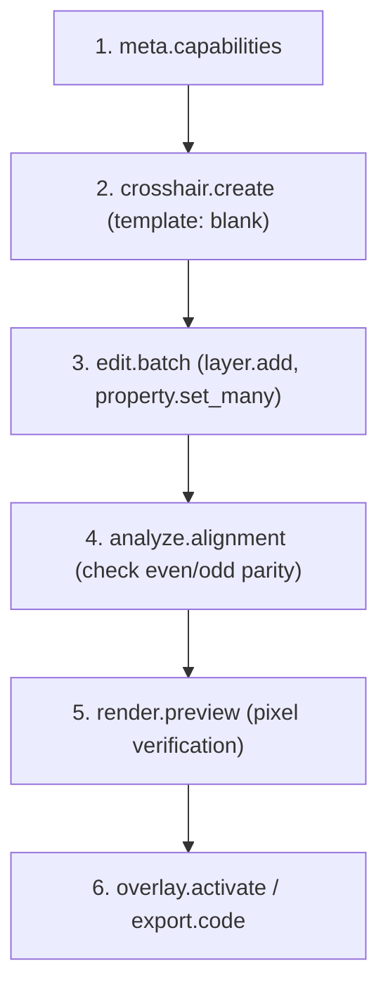

# XHAIR — Agent Guide & Reference (v5)

This document is written specifically for AI agents, CLI automations, and MCP clients interacting with the XHAIR crosshair engine.

---

## 1. Coordinate System & Fundamentals
- **Origin `(0, 0)` is screen & reticle center.**
- **`+x` points right, `+y` points down.**
- Units are **game pixels** (logical unscaled pixels mapped to physical display pixels via current resolution profile).
- **Start blank, add at center:** A blank crosshair begins with 0 layers and only a center marker. Every added shape row defaults to `(0, 0)` and becomes its own independently selectable and transformable layer.

---

## 2. Golden Agent Workflow
Follow this deterministic sequence for creating or editing reticles:



1. **`meta.capabilities`**: Check subsystem availability (Overlay, MCP transport, Dynamics).
2. **`crosshair.create`** or **`crosshair.get`**: Initialize a blank workspace or load existing document.
3. **`edit.batch`**: Apply atomic layer additions and property mutations under a single undo step.
4. **`analyze.alignment`**: Verify parity with display resolution (pixel-edge vs pixel-middle centering).
5. **`render.preview`**: Render PNG preview (scale 16x) to visually verify pixel rasterization.
6. **`overlay.activate`**: Push reticle live to the desktop overlay slot.
7. **`export.code`**: Return compressed Brotli share code (`XH1-...`) to user.

---

## 3. Schema-Driven Property Model (§9)
Discover and manipulate properties using schema descriptors:
- **`property.list`**: Returns descriptors with `id`, `unit`, `min`, `max`, `step`, `default`, `group`, and `keywords`.
- **`property.get { property_id }`**: Fetches active value.
- **`property.set { property_id, value }`**: Sets individual property.
- **`property.set_many { properties: { ... } }`**: Updates multiple attributes atomically.
- **`property.reset { property_id }`**: Resets target property back to its descriptor default.
- **`property.link { property_a, property_b, linked: true }`**: Links paired parameters (e.g. width/height, x/y).
- **Overrides Cascade:** Properties follow strict inheritance: `Crosshair Global -> Layer -> Arm/Vertex Override`.

---

## 4. Key Agent Gotchas
1. **Even vs Odd Centering:** On even-width screens (e.g. 1920×1080), the true center is a pixel boundary (edge). Even-thickness shapes align crisply; odd-thickness shapes require half-pixel offsets (`0.5 px`) or Smooth AA mode.
2. **Crisp vs Smooth Sub-pixel Nudges:** In Crisp mode, fractional sub-pixel nudges require Smooth mode; check `analyze.alignment` diagnostic message.
3. **Selection Independence:** Always specify explicit `ids` in editing commands (`layer_id`, `target_layer_ids`, `crosshair_id`). Do not depend on UI cursor selection.
4. **Appearance Tools Never Mutate Crosshairs:** Tools such as `theme.set`, `font_pack.list`, and `appearance.set` modify only the editor chrome. Reticle colors and geometry remain untouched.
5. **Headless vs App Mode:** Appearance (`theme.*`) and Dock (`ui.panel.*`, `ui.layout.*`) return `unavailable_in_mode` when running in pure headless MCP daemon mode.

---

## 5. Copy-Paste Recipes (MCP JSON)

### Recipe A: Classic Plus with Center Gap
```json
{
  "commands": [
    { "type": "layer.add", "kind": "LineArms", "at": "center" },
    { "type": "property.set_many", "properties": {
      "line.thickness": 2.0,
      "line.length": 6.0,
      "line.gap": 4.0,
      "line.arm_count": 4,
      "paint.color": "#00FF66FF"
    }}
  ]
}
```

### Recipe B: Precision 2px Center Dot Only
```json
{
  "commands": [
    { "type": "layer.add", "kind": "Dot", "at": "center" },
    { "type": "property.set_many", "properties": {
      "dot.diameter": 2.0,
      "dot.is_square": true,
      "paint.color": "#FF3B30FF"
    }}
  ]
}
```

### Recipe C: Dashed Tactical Ring with Glow
```json
{
  "commands": [
    { "type": "layer.add", "kind": "Ring", "at": "center" },
    { "type": "property.set_many", "properties": {
      "ring.outer_radius": 10.0,
      "ring.thickness": 1.5,
      "effect.glow_radius": 3.0,
      "paint.color": "#38BDF8FF"
    }}
  ]
}
```

### Recipe D: Recenter Whole Crosshair
```json
{
  "name": "crosshair.recenter",
  "arguments": { "crosshair_id": "ch-active" }
}
```

### Recipe E: Add to Crosshair Group ("Valorant")
```json
{
  "name": "group.add",
  "arguments": {
    "group_id": "grp-val",
    "crosshair_ids": ["ch-active"]
  }
}
```

### Recipe F: Switch Theme to Graphite Mint
```json
{
  "name": "theme.set",
  "arguments": { "id": "graphite-mint" }
}
```

---

## 6. Error Catalog & Recovery

| Error Code | Meaning | Remediation |
|---|---|---|
| `ERR_NOT_FOUND` | Crosshair, layer, or group ID does not exist | Run `library.list` or `group.list` to query valid IDs. |
| `ERR_VALIDATION` | Value out of descriptor bounds (`min`/`max`) | Check `property.list` bounds before calling `property.set`. |
| `ERR_OVERLAY_UNAVAILABLE` | Overlay renderer process inactive | Ensure desktop overlay is started or activate via `overlay.activate`. |
| `ERR_UNAVAILABLE_IN_MODE` | App-only tool called in headless mode | UI appearance and dock tools are unavailable in headless daemon mode. |
| `ERR_SAFETY_VIOLATION` | Attempted unconfirmed dynamic reticle action | Pass `confirm_risk: true` to `dynamics.set_enabled`. |

---

## 7. Section 14.3 Walkthrough: Full Scripted Session
The standard end-to-end milestone workflow:
1. `crosshair.create { template: "blank" }` -> returns `crosshair_id: "ch-v5-demo"`
2. `layer.add { crosshair_id: "ch-v5-demo", kind: "LineArms", at: "center" }`
3. `property.set_many { properties: { "line.thickness": 2, "line.gap": 4, "line.length": 6 } }`
4. `layer.add { crosshair_id: "ch-v5-demo", kind: "Dot", at: "center" }`
5. `property.set { property_id: "dot.diameter", value: 2.0 }`
6. `layer.add { crosshair_id: "ch-v5-demo", kind: "Ring", at: "center" }`
7. `property.set { property_id: "ring.thickness", value: 1.0 }`
8. `property.set { property_id: "line.length_top", value: 8.0 }` (per-arm override)
9. `style.save_preset { name: "Cyan Sniper" }`
10. `analyze.alignment { crosshair_id: "ch-v5-demo" }` -> verify 0 alignment issues
11. `render.preview { crosshair_id: "ch-v5-demo", scale: 16 }` -> inspect visual PNG
12. `nudge { target: "arm", arm_index: 0, dy: -0.5 }`
13. `layer.recenter { layer_id: "layer-1" }`
14. `group.add { group_id: "grp-val", crosshair_ids: ["ch-v5-demo"] }`
15. `theme.set { id: "mono-dark" }`
16. `overlay.activate { id: "ch-v5-demo" }`
17. `export.code { crosshair_id: "ch-v5-demo" }` -> returns `XH1-...`
