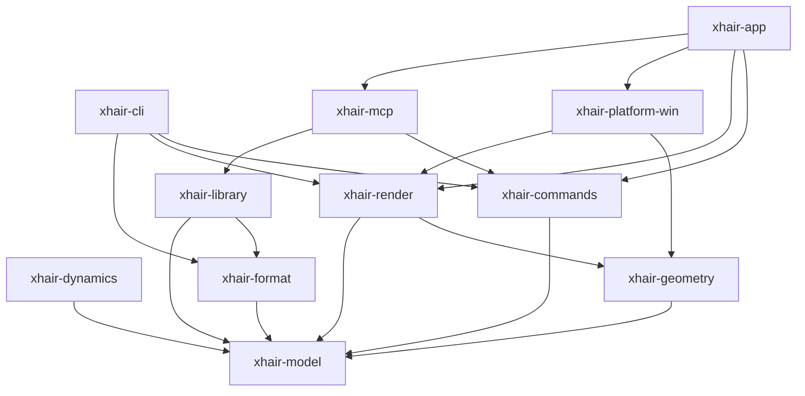

# Architecture & Dependency Graph

*Generated automatically by `cargo xtask graph` — do not hand-edit.*

## Crate Responsibilities
- **xhair-model**: Core domain types, serialization, JSON schema derivation, and zero-I/O validation.
- **xhair-geometry**: Coordinate conversion, edge vs pixel centers, DPI scaling, and custom aspect stretch math.
- **xhair-commands**: Pure command bus, transaction batching, undo/redo stacks, and property descriptors.
- **xhair-render**: CPU rasterizer based on tiny-skia, multi-pass blur, bloom, and arm symmetry. Compiles to native and wasm32.
- **xhair-format**: File format parser and serializers (.xhair, .xhairpack, compressed share codes, Valorant code importer).
- **xhair-library**: File-system persistence, folder tree, tags, slots, atomic write handling, and index cache.
- **xhair-platform-win**: Windows Win32 layered click-through transparent window, monitor enumeration, and hotkeys.
- **xhair-dynamics**: Pure state-machine simulation for dynamic reticle spread curves (opt-in only).
- **xhair-mcp**: Model Context Protocol (MCP) server providing stdio and HTTP transports for AI agent automation.
- **xhair-app**: Tauri application shell, system tray integration, lazy editor window lifecycle.
- **xhair-cli**: Command-line interface for offline rendering, validation, and MCP stdio proxying.
- **xtask**: Repository automation for graph analysis, continuity checking, and packaging.
